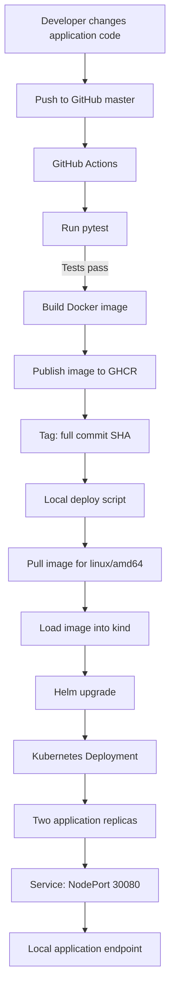
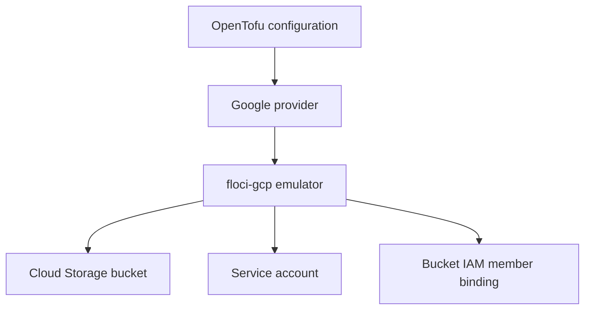

# GitOps Platform with OpenTofu

A local, portfolio-ready demonstration of infrastructure provisioning, containerization, Kubernetes deployment, Helm releases, and CI/CD using GitHub Actions and GitHub Container Registry (GHCR).

> **Environment note:** This project is validated locally with a GCP-compatible emulator and a `kind` Kubernetes cluster. It does **not** provision or deploy to a real Google Cloud project or a real GKE cluster. The delivery workflow uses GitHub Actions to build and publish images, followed by an explicit local deployment command that updates Helm on `kind`.

## Project overview

The project demonstrates a delivery path from a source-code change to a versioned container image and a running Kubernetes workload:

1. A change is pushed to the `master` branch.
2. GitHub Actions installs dependencies and runs the application tests.
3. On pushes to `master`, the workflow builds a Docker image and publishes it to GHCR.
4. The image is tagged with `latest` and the full commit SHA.
5. The local deployment script pulls the selected SHA-tagged image, loads it into `kind`, upgrades the Helm release, waits for the rollout, and checks the application's health endpoint.

The deployment uses a specific commit SHA rather than relying on the mutable `latest` tag. This makes it possible to identify exactly which application revision is running and to redeploy an earlier published version.

## Architecture



Infrastructure provisioning is a separate local workflow:



## Technology stack

| Area | Technology |
|---|---|
| Infrastructure as Code | OpenTofu |
| GCP API emulation | floci-gcp |
| Application | Python, FastAPI, Uvicorn |
| Containerization | Docker |
| Local Kubernetes | kind |
| Kubernetes packaging | Helm |
| CI/CD | GitHub Actions |
| Container registry | GitHub Container Registry |
| Automated tests | pytest |

## Repository layout

```text
.
├── .github/
│   └── workflows/
│       └── ci-cd.yaml
├── app/
│   ├── __init__.py
│   ├── main.py
│   └── requirements.txt
├── helm/
│   └── gitops-platform/
│       ├── Chart.yaml
│       ├── values.yaml
│       └── templates/
├── infra/
│   ├── versions.tf
│   ├── providers.tf
│   └── main.tf
├── k8s/
│   ├── deployment.yaml
│   └── service.yaml
├── scripts/
│   └── deploy-local.sh
├── tests/
│   └── test_main.py
├── .gitignore
├── Dockerfile
├── docker-compose.floci.yml
└── kind-config.yaml
```

Some generated Helm chart files and local runtime data are omitted from this overview.

## Application endpoints

| Endpoint | Purpose |
|---|---|
| `GET /` | Application welcome message and status |
| `GET /health` | Health check used by Kubernetes probes and the deployment script |
| `GET /version` | Application version and runtime timestamp |

The application listens on port `8000` inside the container. The Kubernetes Service exposes it locally at:

- Application: `http://localhost:30080/`
- Health check: `http://localhost:30080/health`
- Version: `http://localhost:30080/version`

## Prerequisites

Install the following tools on your Linux machine:

- Docker
- kind
- kubectl
- Helm
- OpenTofu
- Git
- Python 3.12 (recommended for local testing)

You also need a GitHub repository with GitHub Actions enabled. The workflow uses the built-in `GITHUB_TOKEN` to publish packages; it grants the `packages: write` permission to the image publishing job.

## Run locally

### 1. Clone the repository

```bash
git clone https://github.com/zeeshan40132/gke-gitops-platform.git
cd gke-gitops-platform
```

### 2. Start the GCP emulator

Start the emulator using Docker Compose:

```bash
docker compose -f docker-compose.floci.yml up -d
```

Check the emulator's legacy health endpoint:

```bash
curl -i http://localhost:4588/_floci-gcp/health
```

The emulator's API surface is not identical to Google Cloud. The project uses only the emulator endpoints and resource operations that have been tested.

### 3. Provision the demo infrastructure with OpenTofu

```bash
cd infra
tofu init
tofu validate
tofu plan
tofu apply
```

Review the plan before applying. The current configuration creates:

- A Cloud Storage bucket.
- A service account.
- A bucket-level IAM member binding granting `roles/storage.objectAdmin` to that service account.

The Google provider is configured to use the local emulator endpoints. The configured project name is `floci-local`; this is not a real GCP project.

Return to the repository root:

```bash
cd ..
```

### 4. Create the local kind cluster

From the repository root:

```bash
kind create cluster --config kind-config.yaml
kubectl get nodes
```

The cluster is named `gitops-local`.

### 5. Run application tests

```bash
python3 -m venv .venv
source .venv/bin/activate
python -m pip install --upgrade pip
python -m pip install -r app/requirements.txt pytest httpx
python -m pytest -v
```

### 6. Build and test the Docker image

```bash
docker build -t gitops-platform-app:1.0.0 .
docker run --rm -p 8000:8000 gitops-platform-app:1.0.0
```

In another terminal, test the endpoints:

```bash
curl http://localhost:8000/
curl http://localhost:8000/health
curl http://localhost:8000/version
```

Stop the foreground container with `Ctrl+C`.

### 7. Deploy with Helm

The GitHub Actions workflow publishes the image to GHCR. The package is public in the current project setup, so a local registry login is not needed to pull it.

Deploy a specific published commit image:

```bash
bash scripts/deploy-local.sh sha-<FULL_COMMIT_SHA>
```

For example, the following commit was successfully deployed during project validation:

```bash
bash scripts/deploy-local.sh sha-11fdaa0613f1305b69a3e96a7628830cdd3fdfd0
```

The script:

1. Pulls the selected image for `linux/amd64`.
2. Loads the image into the `gitops-local` kind cluster.
3. Runs `helm upgrade --install` with the selected image repository and tag.
4. Waits for the Kubernetes Deployment rollout.
5. Checks `http://localhost:30080/health`.

Verify the deployment:

```bash
kubectl get pods -l app=gitops-platform-app
kubectl get deployment gitops-platform-app \
  -o jsonpath='{.spec.template.spec.containers[0].image}{"\n"}'
curl -i http://localhost:30080/health
curl http://localhost:30080/
```

## CI/CD workflow

Workflow file: `.github/workflows/ci-cd.yaml`

The workflow has two jobs:

### Test application

- Runs on pushes and pull requests targeting `master`.
- Checks out the repository.
- Sets up Python 3.12.
- Installs application and test dependencies.
- Runs `python -m pytest -v`.

### Build and publish image

- Runs only on pushes (after the test job succeeds).
- Authenticates to GHCR using `GITHUB_TOKEN`.
- Builds the Docker image for `linux/amd64`.
- Publishes the `latest` tag and a full commit-SHA tag.

The commit-SHA tag provides an immutable version reference for deployment and rollback, whereas `latest` is a moving tag.

## Rollback

To roll back, deploy a previously published commit-SHA image using the same script:

```bash
bash scripts/deploy-local.sh sha-<PREVIOUS_FULL_COMMIT_SHA>
```

This pulls the previous image, loads it into kind, and updates the Helm release to that image. The previous image must still exist in GHCR.

Inspect Helm release history:

```bash
helm history gitops-platform
```

You can also inspect the currently deployed image:

```bash
kubectl get deployment gitops-platform-app \
  -o jsonpath='{.spec.template.spec.containers[0].image}{"\n"}'
```

## Kubernetes configuration

The Helm chart configures:

- Two application replicas by default.
- A NodePort Service on port `30080`.
- Readiness and liveness probes against `/health`.
- CPU and memory requests and limits.
- A configurable image repository and tag.
- A revision history limit for the Deployment.

The local kind cluster uses a host port mapping so the application is reachable at `localhost:30080`.

## Security and operational notes

- OpenTofu state files, local emulator data, virtual environments, and environment files are excluded through `.gitignore`.
- The OpenTofu state used in this local demonstration is stored locally. It is not configured with a remote state backend.
- The application container runs as a non-root user.
- The CI workflow uses GitHub's temporary `GITHUB_TOKEN` rather than a hard-coded registry password.
- The GHCR package is public in the current setup. Do not publish sensitive application images publicly.
- Do not commit real cloud credentials, access tokens, private keys, or Terraform/OpenTofu state files.
- The fake emulator access token in the provider configuration is for local emulator use only; it is not a real Google Cloud credential.

## Validation evidence

The following project milestones have been completed and tested:

- OpenTofu successfully applied the three emulator-backed resources: bucket, service account, and IAM member binding.
- The FastAPI application passed its automated tests.
- The Docker image was built and ran locally.
- The application was deployed to kind with two healthy replicas.
- Helm installed and upgraded the application release.
- GitHub Actions successfully ran tests and published images to GHCR.
- A commit-SHA image was pulled, loaded into kind, and deployed through Helm.
- The deployed application returned HTTP 200 from `/health`.
- The deployed root endpoint returned the updated message: `GitOps deployment update successful`.
- The Kubernetes Deployment reported the exact image tag `sha-11fdaa0613f1305b69a3e96a7628830cdd3fdfd0`.

## Current limitations and future improvements

This repository is a local demonstration and intentionally does not claim production GKE deployment.

Possible next improvements:

- Replace the local emulator with a real GCP project and provision a real GKE cluster.
- Configure remote OpenTofu state with locking and access controls.
- Add automated security scanning for dependencies and container images.
- Add a staging environment and a controlled promotion process.
- Introduce a GitOps controller such as Argo CD after validating the required cluster networking and resource budget.
- Add monitoring, metrics, centralized logs, and alerting.
- Add image signing and software bill of materials (SBOM) generation.

## Author

**Zeeshan Akram**

GitHub: [@zeeshan40132](https://github.com/zeeshan40132)

Repository: [gke-gitops-platform](https://github.com/zeeshan40132/gke-gitops-platform)
