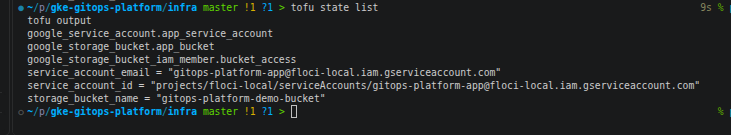
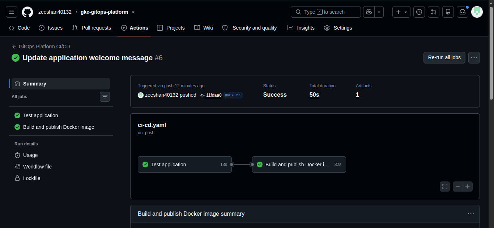
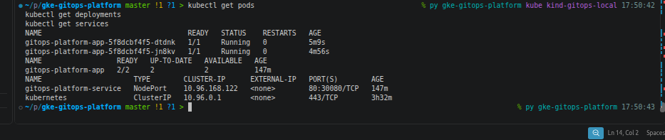
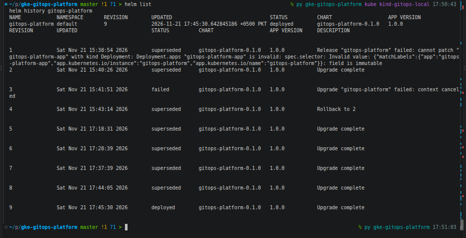
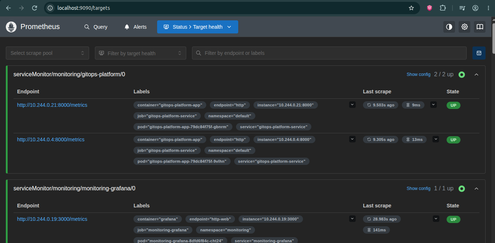
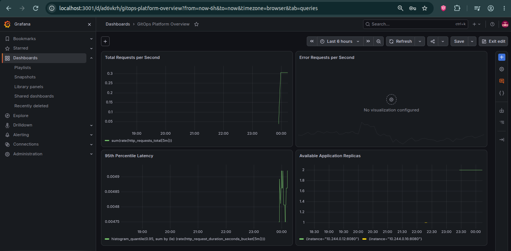
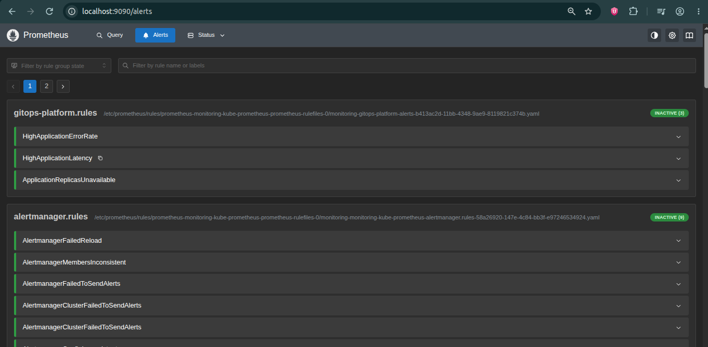
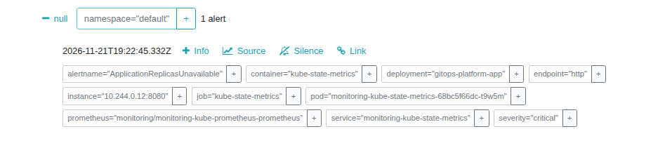

# GitOps Platform with OpenTofu, Kubernetes & Observability

A local DevOps platform demonstrating Infrastructure as Code,
containerization, CI/CD automation, Kubernetes deployments, Helm-based
release management, and monitoring with Prometheus, Grafana, and
Alertmanager.

The project uses a local Kubernetes cluster created with **kind** and
the **floci-gcp emulator** to validate supported Google Cloud
infrastructure resources without requiring a real GCP account.

------------------------------------------------------------------------

## Architecture

``` text
                 Developer
                     |
                     v
                 GitHub Repo
                     |
                GitHub Actions
                     |
              +------+------+
              |             |
          Run Tests     Build Docker
                            |
                            v
                     GitHub Container
                       Registry
                            |
                            v
                     Local Deployment
                            |
                     Kubernetes (kind)
                            |
                     Helm Deployment
                            |
                   FastAPI Application
                            |
                  Prometheus Metrics
                            |
                     Prometheus
                            |
                  +---------+---------+
                  |                   |
                Grafana           Alertmanager
               Dashboard          Alert Routing
```

### Infrastructure architecture

``` text
                  OpenTofu
                     |
                     v
               floci-gcp Emulator
                     |
             +-------+--------+
             |                |
        Cloud Storage    IAM Service Account
             |
       Bucket IAM Binding
```

------------------------------------------------------------------------

## Technology Stack

  Category                  Technologies
  ------------------------- ----------------------------------
  Infrastructure as Code    OpenTofu
  Cloud emulation           floci-gcp
  Containerization          Docker
  Container registry        GitHub Container Registry (GHCR)
  Orchestration             Kubernetes (kind)
  Package management        Helm
  CI/CD                     GitHub Actions
  Application               Python, FastAPI
  Testing                   Pytest
  Monitoring                Prometheus
  Visualization             Grafana
  Alert management          Alertmanager
  Metrics instrumentation   prometheus-client

------------------------------------------------------------------------

## Project Features

### 1. Infrastructure as Code

Infrastructure resources are provisioned using OpenTofu with the Google
provider configured to communicate with the local floci-gcp emulator.

Resources provisioned:

-   Google Cloud Storage bucket
-   Google Cloud IAM service account
-   Storage bucket IAM binding

Infrastructure is managed declaratively through OpenTofu configuration
files.

**Commands:**

``` bash
cd infra

tofu init
tofu validate
tofu plan
tofu apply
```

### 2. FastAPI Application

A lightweight FastAPI application provides:

  Endpoint     Purpose
  ------------ ---------------------------------
  `/`          Application home and status
  `/health`    Health check endpoint
  `/version`   Application version information
  `/metrics`   Prometheus metrics

The application includes HTTP request counters, error counters, and
request latency histograms.

### 3. Docker Containerization

The application is packaged into a Docker image using a custom
Dockerfile.

Implementation includes:

-   Python slim base image
-   Dependency installation
-   Non-root application user
-   Exposed application port
-   Containerized FastAPI server

The image is published to GitHub Container Registry.

**Image:**

`ghcr.io/zeeshan40132/gke-gitops-platform`

### 4. Kubernetes Deployment

The application is deployed to a local Kubernetes cluster created using
kind.

Features include:

-   Two application replicas
-   Kubernetes Deployment and Service resources
-   NodePort service exposure
-   Readiness and liveness probes
-   CPU and memory requests and limits
-   Automatic pod replacement
-   Deployment scaling

The application is accessible locally at:

`http://localhost:30080`

### 5. Helm-Based Deployment

A custom Helm chart manages the application's Kubernetes resources.

The chart includes configurable values for:

-   Replica count
-   Container image and tag
-   Service configuration
-   Health probes
-   Resource requests and limits
-   Deployment revision history

Helm also provides release history and rollback functionality.

**Useful commands:**

``` bash
helm list

helm history gitops-platform

helm upgrade gitops-platform helm/gitops-platform

helm rollback gitops-platform <REVISION>
```

### 6. GitHub Actions CI/CD

GitHub Actions automates application testing and Docker image
publishing.

The pipeline consists of two jobs:

**Test Application** - Checks out the repository - Sets up Python -
Installs dependencies - Runs Pytest

**Build and Publish Docker Image** - Runs after successful tests -
Builds the Docker image - Authenticates to GHCR using GitHub Actions'
`GITHUB_TOKEN` - Publishes the image to GitHub Container Registry

Images are published with: - `latest` tag - Git commit SHA tag

The workflow runs on pushes and pull requests targeting the `master`
branch. Image publishing is performed on pushes.

### 7. Monitoring with Prometheus

The monitoring stack is installed using the `kube-prometheus-stack` Helm
chart.

Prometheus collects application metrics through a Kubernetes
ServiceMonitor.

The application exposes:

-   `http_requests_total`
-   `http_errors_total`
-   `http_request_duration_seconds`

Prometheus successfully scrapes both application replicas.

The monitoring stack also collects Kubernetes and infrastructure-related
metrics from supported exporters and components.

### 8. Grafana Dashboard

Grafana provides a dashboard for monitoring application performance.

The custom dashboard includes:

  Panel                     Metric
  ------------------------- ------------------------------------
  Total Requests/sec        HTTP request rate
  Error Requests/sec        HTTP error rate
  95th Percentile Latency   Application request latency
  Available Replicas        Kubernetes deployment availability

Grafana is accessible locally through port forwarding:

``` bash
kubectl port-forward -n monitoring svc/monitoring-grafana 3001:80
```

Open `http://localhost:3001`.

### 9. Prometheus Alerting and Alertmanager

Three custom Prometheus alert rules monitor application health.

  ----------------------------------------------------------------------------
  Alert                              Condition            Severity
  ---------------------------------- -------------------- --------------------
  `HighApplicationErrorRate`         Error rate exceeds   Warning
                                     10%                  

  `HighApplicationLatency`           95th percentile      Warning
                                     latency exceeds 500  
                                     ms                   

  `ApplicationReplicasUnavailable`   Fewer than two       Critical
                                     replicas available   
  ----------------------------------------------------------------------------

The rules use a two-minute pending period before firing.

**Alert testing**

The replica availability alert was tested by scaling the application
from two replicas to one:

``` bash
kubectl scale deployment gitops-platform-app --replicas=1
```

Prometheus detected the reduced replica count and fired the
`ApplicationReplicasUnavailable` alert.

Alertmanager successfully received the critical alert.

The deployment was subsequently restored:

``` bash
kubectl scale deployment gitops-platform-app --replicas=2
```

This validated the monitoring and alert delivery path:

``` text
Kubernetes
    |
    v
kube-state-metrics
    |
    v
Prometheus
    |
    v
Prometheus Alert Rule
    |
    v
Alertmanager
```

Alertmanager receives and manages alerts. External email or webhook
notification delivery has not been configured.

------------------------------------------------------------------------

## Screenshots

Project screenshots are stored in `docs/screenshots/`.

### Infrastructure



*OpenTofu provisioning the infrastructure resources through the local
floci-gcp emulator.*

### CI/CD



*GitHub Actions workflow showing the automated CI/CD pipeline.*

### Kubernetes and Helm



*Local Kubernetes deployment and application workloads.*



*Helm release management for the application.*

### Observability



*Prometheus targets, including the application metrics endpoints.*



*Custom Grafana dashboard for application monitoring.*



*Custom Prometheus alert rules.*



*Alertmanager receiving the application replica availability alert.*

------------------------------------------------------------------------

## Repository Structure

``` text
gke-gitops-platform/
│
├── .github/
│   └── workflows/
│       └── ci-cd.yaml
│
├── app/
│   ├── main.py
│   └── requirements.txt
│
├── infra/
│   ├── main.tf
│   ├── providers.tf
│   └── versions.tf
│
├── helm/
│   └── gitops-platform/
│       ├── Chart.yaml
│       ├── values.yaml
│       └── templates/
│
├── k8s/
│   ├── deployment.yaml
│   └── service.yaml
│
├── monitoring/
│   ├── values.yaml
│   ├── service-monitor.yaml
│   └── alert-rules.yaml
│
├── scripts/
│   └── deploy-local.sh
│
├── tests/
│   └── test_main.py
│
├── docs/
│   └── screenshots/
│
├── Dockerfile
├── docker-compose.floci.yml
├── kind-config.yaml
├── .gitignore
└── README.md
```

------------------------------------------------------------------------

## Running Locally

### Prerequisites

Install the following tools:

-   Docker
-   kind
-   kubectl
-   Helm
-   OpenTofu
-   Git
-   Python 3

### 1. Clone the repository

``` bash
git clone https://github.com/zeeshan40132/gke-gitops-platform.git

cd gke-gitops-platform
```

### 2. Start the local GCP emulator

``` bash
docker compose -f docker-compose.floci.yml up -d
```

### 3. Provision infrastructure

``` bash
cd infra

tofu init
tofu plan
tofu apply

cd ..
```

### 4. Create the local Kubernetes cluster

``` bash
kind create cluster --config kind-config.yaml
```

### 5. Deploy the application

Use the included deployment script with an image tag:

``` bash
bash scripts/deploy-local.sh latest
```

### 6. Access the application

`http://localhost:30080`

### 7. Access monitoring

**Prometheus**

``` bash
kubectl port-forward -n monitoring svc/monitoring-kube-prometheus-prometheus 9090:9090
```

`http://localhost:9090`

**Grafana**

``` bash
kubectl port-forward -n monitoring svc/monitoring-grafana 3001:80
```

`http://localhost:3001`

**Alertmanager**

``` bash
kubectl port-forward -n monitoring svc/monitoring-kube-prometheus-alertmanager 9093:9093
```

`http://localhost:9093`

------------------------------------------------------------------------

## Security and Best Practices

-   OpenTofu state files and local emulator data are excluded from Git.
-   Environment files and secrets are excluded through `.gitignore`.
-   GitHub Actions uses the built-in `GITHUB_TOKEN` for GHCR
    authentication.
-   The FastAPI container runs as a non-root user.
-   Kubernetes workloads have resource requests and limits.
-   Health probes are configured for application availability.
-   Application metrics are exposed through a dedicated endpoint.

**Important:** Never commit OpenTofu state files, credentials, access
tokens, or generated secret values.

------------------------------------------------------------------------

## Implementation Scope and Limitations

This repository demonstrates a local DevOps and GitOps-oriented
platform.

-   Kubernetes deployment and monitoring are validated on a local kind
    cluster, not on Google Kubernetes Engine.
-   Google Cloud infrastructure resources are provisioned through the
    floci-gcp emulator, not a real GCP project.
-   Emulator support depends on the individual API and resource
    implementation.
-   Argo CD core was installed during development but scaled down. The
    current application and monitoring deployments are managed directly
    through Helm, rather than an active Argo CD reconciliation workflow.
-   Alertmanager receives and manages Prometheus alerts, but external
    notification delivery has not been configured.

These boundaries distinguish locally verified functionality from
production cloud deployment.

------------------------------------------------------------------------

## Author

**Zeeshan Akram**

GitHub: [@zeeshan40132](https://github.com/zeeshan40132)

Repository:
[gke-gitops-platform](https://github.com/zeeshan40132/gke-gitops-platform)
